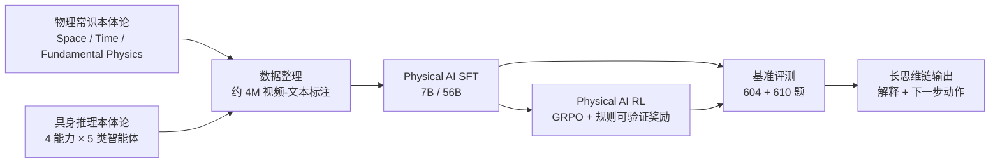

# 深度阅读：Cosmos-Reason1

> 📄 对应论文：[Cosmos-Reason1](https://www.alphaxiv.org/zh/abs/2503.15558)（[arXiv:2503.15558](https://arxiv.org/abs/2503.15558)）
> 整理者：@VoVL773
> 最后更新：2026-10-31

---

> 💡 深度阅读与个人理解合并为一份。以下角度**按论文特点取舍**，不要求全部填写；建议至少写「核心方法」和「个人收获」。

## 1. 问题与动机

**一句话：** 物理 AI 不缺「会聊天的大模型」，缺的是把常识**扎根到物理世界**、并且能说出「下一步该做什么」的推理模型。

拆开看：

- **要解决什么问题**：物理 AI 系统（Physical AI）要在现实世界里交互，首先得看得懂视频里的空间关系、事件顺序和物理规律，然后基于这些理解生成长思维链（Long CoT）推理，最后给出具身决策（例如下一步动作），而且决策要用自然语言说得清、可检查。

- **为什么重要**：纯文本 LLM 的通用推理很强，但它的知识是「悬空」的。它知道「杯子会掉」，却不一定能把这句话和视频里桌沿、手的姿势、重力方向对应起来。物理 AI 要安全可靠地干活，这种「接地」（grounding）能力绕不过去。

- **之前的做法卡在哪**：
  1. **知识不接地**：互联网文本训练出的 LLM 很难把抽象知识和真实的时空动力学、具身载体的物理约束连起来（§1）。
  2. **缺统一的能力框架**：到底什么叫「懂物理」？没有一套可标注、可评测的本体论，数据就没法系统整理，基准也没法横向比较。
  3. **现有评测测不出来**：论文在 Table 10 里给了一个很扎心的结果——GPT-4o、o1、Gemini 2.0 Flash 在「时间之矢」和「客体永久性」上基本等于瞎猜（50% 上下），但在 MMMU 这类标准基准上分数很好看。说明「考试分高」不等于「懂物理」。
  4. **机器人数据太贵**：真机交互数据量级远比不上互联网图文/视频，靠堆机器人数据补常识不现实。

- **论文的切入点**：先把「物理常识」和「具身推理」定义成两套本体论，再按本体论造数据、造基准、训模型。**先定义能力，再谈模型**，这是这篇论文最像「基础设施」的地方。

## 2. 核心方法

整体是一条流水线：**两套本体论 → 按本体论造 SFT 数据 → Physical AI SFT → 用可验证奖励做 Physical AI RL → 按本体论建基准评测**。

### 2.1 两套本体论：把「懂物理」拆成可标注的格子

**（1）物理常识：3 大类、16 个子类**（§2.1，Fig. 2，Table 1）

| 大类 | 子类 | 关心什么 |
|------|------|----------|
| **Space（空间）** | Relationship | 物体的空间关系；注意视角——是「在人左边」还是「在画面左边」 |
| | Plausibility | 某个空间关系在物理上是否可行 |
| | Affordance | 物体与主体（人、动物、机器人）的交互可能性 |
| | Environment | 理解场景与周围环境 |
| **Time（时间）** | Actions | 描述动作（方向、强度等）、判断目标、拆解子任务、判断任务是否完成 |
| | Order | 事件的时间戳与先后顺序 |
| | Causality | 事件 A 是否导致事件 B |
| | Camera | 相机的位置与运动、机位、镜头切换 |
| | Planning | 基于过去观察给出未来计划 |
| **Fundamental Physics（基础物理）** | Attributes | 语义描述、大小、颜色、材质、质量、温度、可穿透性等 |
| | States | 物体状态与状态变化（冰化水、生鸡蛋变熟） |
| | Object Permanence | 客体永久性：物体被遮挡后是否仍存在、哪些属性可变 |
| | Mechanics | 静力学、运动学、动力学（重力、碰撞、摩擦、惯性、动量守恒等） |
| | Electromagnetism | 光学（光影、遮挡、反射、折射）、电、磁 |
| | Thermodynamics | 热、温度变化、蒸发、传热、热胀冷缩 |
| | Anti-Physics | 反物理现象：反重力、时间倒流、永动机、瞬间消失等 |

这里有个小细节：§2.1 正文写的是 "Accordance"，但 Table 1 写的是 "Affordance"。以表格为准，正文应是笔误。

**（2）具身推理：4 种能力 × 5 类智能体**（§2.2，Table 2）

- 4 种能力：① 处理复杂感知输入；② 预测动作后果；③ 遵守物理约束；④ 从交互中学习。
- 5 类智能体：人、动物、机械臂、人形机器人、自动驾驶车。
- 论文**只做前三种能力**，「从交互中学习」留作未来工作（§2.2）。落到具体任务上是三件事：
  - **task-completion verification**：任务/子任务完成了吗？
  - **action affordance**：这个动作在当前场景做得到吗？
  - **next plausible action prediction**：下一步最可能做什么？

这相当于把「具身推理」变成了一张二维表，每个格子都能出题、能标注、能评测。这个设计比很多只给一句「要懂物理」的论文要实在。

### 2.2 模型架构：视觉编码器 + 投影器 + 解码器 LLM

- 采用 **decoder-only** 多模态架构（类似 LLaVA / NVLM-D）：视频先过视觉编码器，再由投影器（两层 MLP，带下采样）对齐到文本 token 的嵌入空间，最后送进 LLM（§3.1，Fig. 3）。
- **7B**：以 **Qwen2.5-VL** 为预训练底座，沿用其图像/视频处理方式；LLM 是 28 层 dense Transformer，视觉编码器 ViT-676M（Table 3）。
- **56B**：视觉编码器 **InternViT-300M-V2.5**，LLM backbone 是 **Nemotron-H** 的 Hybrid Mamba-MLP-Transformer（118 层）。视频最多均匀采样 32 帧、最高 2 fps，每帧 448×448；每帧 1024 个 visual token，经 PixelShuffle 2×2 下采样到 256 个（§3.1、§3.2）。
- 选 Hybrid 的理由很直接：Transformer 自注意力对上下文是二次复杂度，Mamba 是线性复杂度；但纯 Mamba 对长序列细节不够，所以掺少量 Transformer 层补长上下文建模（§3.2）。

### 2.3 训练：先 SFT，再 RL

**第一阶段：Physical AI SFT（§5.1）**

数据整理走同一条「五步流水线」：

1. **人选视频**：人工挑高质量片段；
2. **详细描述**：人工或 VLM 生成结构化 caption（物体、属性、动作、状态）；
3. **造 QA**：让 LLM 基于 caption 生成 free-form 题和 MCQ；题目分「understanding」（caption 里能直接看出来）和「reasoning」（必须多想一步、不能直接从 caption 抄答案）；
4. **蒸馏思维链**：把 caption + 问题喂给 **DeepSeek-R1**，解析出 thinking trace 和最终答案；
5. **清洗改写**：规则清洗，删掉「根据描述……」这类不该出现在训练样本里的引用。

关键点：**问题必须无法直接从 caption 得到答案**，否则 R1 会直接抄，思维链就废了（§5.1.1）。这是个很实际的数据工程经验。

数据规模（Table 4）：

| 数据源 | Understanding | Reasoning | 说明 |
|--------|--------------:|----------:|------|
| 物理常识 free-form | 99K | 59.4K | 9.9K 视频，人工 caption 平均 297.4 词 |
| 物理常识 MCQ | 1.2M | 605.0K | 正文称生成约 2.4M understanding MCQ，表格记 1.2M |
| BridgeData V2 | 129.2K | 129.1K | 机械臂操作；只做 next action 预测 |
| RoboVQA | 218.5K | 920.0K | 机器人/人/人+工具；覆盖规划、完成验证、可供性等 |
| AgiBot | 19.4K | 19.4K | 3,300 段视频切成 19.8K clips；只做下一子任务预测 |
| HoloAssist | 136.3K | 136.3K | 第一视角人类操作，含错误与纠正 |
| AV（自车） | 12.4K | 12.3K | 约 70 小时，人工 caption，避免 VLM 幻觉 |
| **直觉物理** | - | 11.0K / 30.0K / 10.0K | 空间拼图 / 时间之矢 / 客体永久性 |
| **合计** | **1.81M** | **1.93M** | ≈ 3.74M，正文概括为「约 4M」 |

直觉物理这三类数据是**自监督构造**的，很巧（§5.1.3）：

- **空间拼图**：取首帧切成 2×2 四块打乱，再混入 7 张干扰图的 2×2 块，共 32 帧，让模型判断每块在原图的左/上/下/右位置；
- **时间之矢**：拿 Cosmos-Predict1 训练视频，正放 + 倒放各一份，让模型判断播放方向；
- **客体永久性**：用 Libero 仿真环境，相机绕桌运动制造遮挡，随机删掉被完全遮挡的物体，让模型判断有没有物体「不该消失却消失了」。

**第二阶段：Physical AI RL（§4、§5.2）**

- 算法用 **GRPO**：不训练 critic，优势函数在一组回答内做归一化，简单省算力。
- 奖励是**基于规则、可验证**的两项（§7.2.1）：
  - **accuracy reward**：`<answer>` 里的选项和标准答案字符串匹配；
  - **format reward**：正则检查有没有 `<think>...</think>` 和 `<answer>...</answer>` 标签。
- 为了能用规则判分，把 SFT 里的 reasoning 样本**转成单选题**（去掉思维链），共 **30,304** 道：常识 5,133、具身推理各 200–252、直觉物理 24,079（Table 5）。
- 训练配置：global batch 128，每题采样 9 个输出，最大长度 6,144 token，lr 4×10⁻⁶，KL 系数 0.005，训练 500 步（§7.2.1）。
- 框架上还做了一个**全异步**的 RL 训练框架：policy training 和 actor rollout 异构部署，统一 dispatcher 调度；论文称相比 colocated 框架训练效率提升约 **160%**，且节点故障时能继续训练、支持动态扩缩容（§4.2）。

### 2.4 基准：按本体论出题

- **物理常识**：初始收集 5,737 题（2,828 判断 + 2,909 选择），人工筛出 **604 题 / 426 段视频**（336 判断 + 268 选择）。分布：Space 80 题（13.25%）、Time 298 题（49.33%）、Fundamental Physics 226 题（37.4%）（§6.1）。
- **具身推理**：**610 题 / 600 段视频**，来自 BridgeData V2（100）、RoboVQA（110）、RoboFail（100）、AgiBot（100）、HoloAssist（100）、AV（100）（§6.2，Table 6）。
- 出题时刻意做了三件事：统一问题模板（逼模型看视频而不是猜文字）、统一动作粒度（action / subtask / goal 三层）、人工精修选项（避免选项太像、避免纯文本可推断）（§6.2）。

## 3. 关键结果

### 3.1 SFT 已经很强

**物理常识（Table 7）**

| 模型 | Space | Time | Other Physics | Avg |
|------|------:|-----:|--------------:|----:|
| Gemini 2.0 Flash | 53.8 | 50.0 | 46.9 | 50.2 |
| GPT-4o | 61.3 | 54.7 | 50.9 | 55.6 |
| OpenAI o1 | 63.8 | 58.1 | 58.0 | 59.9 |
| Qwen2.5-VL-7B（7B 底座） | 48.8 | 56.4 | 37.2 | 47.4 |
| Nemotron-H-56B（56B 底座） | 61.3 | 68.1 | 45.1 | 58.2 |
| **Cosmos-Reason1-7B** | 54.2 | 58.7 | 50.0 | **54.3（+6.9）** |
| **Cosmos-Reason1-56B** | 61.3 | 65.5 | 53.9 | **60.2（+2.0）** |

**具身推理（Table 8）**

| 模型 | Bridge | RoboVQA | AgiBot | HoloAssist | AV | RoboFail | Avg |
|------|-------:|--------:|-------:|-----------:|---:|---------:|----:|
| GPT-4o | 42.0 | 71.8 | 32.0 | 65.0 | 46.0 | 63.0 | 53.3 |
| OpenAI o1 | 42.0 | 80.0 | 44.0 | 63.0 | 37.0 | 61.0 | 54.5 |
| Qwen2.5-VL-7B | 38.0 | 82.5 | 40.4 | 50.0 | 36.0 | 57.6 | 50.8 |
| Nemotron-H-56B | 37.0 | 77.2 | 37.0 | 65.0 | 41.0 | 64.0 | 53.5 |
| **Cosmos-Reason1-7B** | 58.8 | 83.8 | 49.4 | 63.0 | 55.6 | 60.0 | **61.8（+11.0）** |
| **Cosmos-Reason1-56B** | 65.0 | 80.0 | 47.6 | 57.8 | 65.8 | 66.2 | **63.7（+10.2）** |

读法：SFT 相对各自 backbone 的提升是实打实的，尤其具身推理 +10 以上；但在物理常识上，56B 只比底座高 2.0，说明「常识」这块底座本来就不弱，数据整理更多是在补 Time 和 Other Physics 的短板。

### 3.2 RL 再往上推一截

**常识 + 具身推理（Table 9，7B）**

| 指标 | SFT | + RL | 变化 |
|------|----:|-----:|-----:|
| 物理常识 | 54.3 | 56.2 | +1.9 |
| BridgeData V2 | 58.8 | 73.5 | +14.7 |
| RoboVQA | 83.8 | 86.8 | +3.0 |
| AgiBot | 49.4 | 54.2 | +4.8 |
| HoloAssist | 63.0 | 60.0 | **−3.0** |
| AV | 55.6 | 67.0 | +11.4 |
| RoboFail | 60.0 | 62.0 | +2.0 |
| **平均（7 项）** | **60.7** | **65.7** | **+5.0** |

**直觉物理（Table 10，7B）**

| 模型 | 时间之矢 | 空间拼图 | 客体永久性 | Avg |
|------|---------:|---------:|-----------:|----:|
| 随机猜 | 50.0 | 25.0 | 50.0 | 41.7 |
| GPT-4o | 50.0 | 77.0 | 48.0 | 58.3 |
| OpenAI o1 | 51.0 | 64.0 | 49.0 | 54.7 |
| Cosmos-Reason1-7B（SFT） | 56.0 | 85.4 | 82.0 | 74.5 |
| **+ Physical AI RL** | **64.5** | **94.0** | **86.0** | **81.5（+7.0）** |

三个最有信息量的点：

1. **现有模型在直觉物理上接近瞎猜**。时间之矢 50% 上下（二选一），客体永久性 48%–49%（二选一），说明它们没真正建立「时间不可逆」和「物体被遮挡仍存在」的概念；空间拼图 GPT-4o 能到 77%，说明模型更擅长静态空间关系，不擅长时间动态。
2. **RL 对直觉物理的提升并不均衡**：空间拼图 +8.6（85.4→94.0）、时间之矢 +8.5（56.0→64.5）、客体永久性 +4.0（82.0→86.0）。时间之矢仍是最弱项——论文自己也承认「reasoning about the arrow of time still remains a challenge」（§7.2.3）。
3. **RL 不是全能**：HoloAssist 掉了 3 分，RoboFail 停滞。论文把 RoboFail 的问题归因于「代表性训练数据不足」，并观察到模型会「想太多」（overthinking）——遇到分布外难题时过度推理反而答错（§7.2.2）。

### 3.3 一个有意思的 RL 现象

Fig. 9 的 AV 例子：题目给的四个选项（右转/左转/右变道/左变道）在当前双黄线场景下**都不合法**。RL 前模型硬选一个（D）；RL 后模型逐项排除，最后**拒绝所有选项**。论文把它解释为 RL 让模型学会了「评估可行性，歧义时选保守」而不是「必须从 ABCD 里挑一个」（§7.2.2）。

这个现象值得记一笔：它说明规则奖励 + MCQ 不一定只教会「选字母」，也可能教会「先判断选项是否成立」。当然，也可能只是模型学会了某种答题套路，论文没有做进一步归因。

## 4. 批判性思考

### 4.1 它到底是不是「具身」模型？

论文标题里的 "Embodied Reasoning" 容易让人误解。严格说，Cosmos-Reason1 输出的是**自然语言形式的下一步动作/子任务**，不是关节角、末端位姿或动作 token；论文也没有做真机闭环执行实验。它更像一个**具身推理器 / 高层规划器**，而不是 VLA 控制器。

这带来两个后果：

- 它的「具身」能力只在**视频问答**层面被验证，离「真机上做完任务」还有距离；
- 如果要接机器人，需要外挂一个低层策略，把「下一步抓水壶」翻译成具体轨迹——这部分论文没做。

把它和 RT-2 / OpenVLA 这类端到端 VLA 对比时要小心：两者评的不是同一件事（VLA 看任务成功率，Cosmos 看选择题正确率）。

### 4.2 只有视觉，缺少「手感」

输入只有视频，没有触觉、力觉、本体感觉、深度/点云。对接触密集的任务（插拔、拧螺丝、摩擦力判断、柔性物体操作），视频里看不到力，模型只能靠先验猜。论文自己也在「具身推理」里把「从交互中学习」列为未来工作（§2.2），但没展开讨论非视觉模态。

### 4.3 长思维链与实时性的矛盾

- 视频最多 32 帧，每帧 256 token，光视觉 token 就 8,192；再叠加上千 token 的长 CoT，56B 模型的自回归解码开销不小。
- 论文没有给推理延迟/吞吐数据（只有训练配置），所以「能不能实时」无法从论文判断。对高频控制（>10 Hz）基本别想直接闭环；作为低频高层决策（几秒一次）更现实。

### 4.4 评测口径偏窄，且有几处数字对不上

- **只测最终答案**：论文明确说思维链质量评估留作未来工作（§6）。这意味着「答对」可能是猜对、也可能是推理过程错的；MCQ 只有 4 个选项，25% 底噪不可忽略。
- **基准规模小**：604 + 610 题，人工精选，覆盖广但每格样本少。Table 8 里 100 题一档，1 题就是 1 个百分点，波动大。
- **「超过 10%」的结论句不严谨**：§9 说 SFT 在两个基准上提升超过 10%，但 Table 7 的常识只有 +6.9 / +2.0。准确说法应是「具身推理提升超过 10%，物理常识提升 2–7 个点」。
- **数据量口径**：正文「约 4M」vs Table 4 的 3.74M；MCQ 正文「2.4M」vs 表格 1.2M。引用时最好写「约 3.7M（Table 4 合计）」。
- **「5 类智能体」但只评了 4 类**：本体论列了人、动物、机械臂、人形机器人、自动驾驶车 5 类，但基准实际覆盖人、机械臂、人形机器人、自动驾驶车；动物没有对应评测。论文也没有说明为什么。

### 4.5 数据工程的隐性风险

- **R1 蒸馏的误差会被放大**：R1 看不到视频，只能读 caption；caption 错 → 思维链错 → SFT 学到错推理。论文的清洗只删「描述/字幕」这类引用，修不了物理错误。
- **AV 数据用人工 caption 是为了避免 VLM 幻觉**（§5.1.2），这反过来说明其他数据源的 VLM caption 可能有幻觉；论文没有给 caption 质量评估。
- **RL 数据靠人工转 MCQ**：论文承认「human-in-the-loop is required ... making it difficult to generate large-scale MCQ data」（§5.2）。所以 RL 数据只有 3 万条，规模和 SFT 差两个数量级；RL 的提升有多少来自数据、多少来自算法，论文没做消融。
- **RL 可能损伤部分能力**：HoloAssist 掉 3 分、RoboFail 不动，说明「所有数据集等概率采样」的策略并不总对；论文没有给 per-dataset 采样权重实验。

### 4.6 规模收益有限

56B 相对 7B：常识 +5.9（60.2 vs 54.3），具身 +1.9（63.7 vs 61.8），直觉物理论文没给 56B 结果。也就是说，**7B 已经拿到大部分收益**，56B 的边际提升不大，但推理成本高一个量级。对个人/小团队，7B 是更实际的起点。

### 4.7 论文没给的东西

- 训练 GPU 时数、费用、数据整理的人力成本；
- 推理延迟、显存占用、量化/蒸馏方案；
- 真机部署或闭环实验；
- 思维链质量的定量评估；
- 与 VLA 模型在同一任务上的端到端对比。

这些空白不影响论文的价值（它定位是「定义能力 + 造数据 + 造基准」），但会影响「能不能直接用」的判断。

## 5. 个人收获

1. **先定义能力，再谈模型。** 这篇论文最值得学的不是某个网络结构，而是「本体论先行」：把「懂物理」拆成 3 大类 16 子类、把「具身推理」拆成 4 能力 × 5 载体，然后数据、基准、模型都围着这张表转。做具身项目时，先想清楚「要评什么能力」，比先选模型更重要。

2. **「先思考、后行动」要落在数据里。** 论文的 SFT 样本不是「问题 → 答案」，而是「问题 → 长思维链 → 答案」；RL 又用 `<think>` / `<answer>` 标签把格式约束住。这和我之前理解的「利用物理引擎或多模态仿真增强机器人理解」是互补的：仿真提供交互和真值，长 CoT 提供可检查的决策过程。两者结合，才是「先思考（Long CoT Reasoning）、后行动（Embodied Decision）」。

3. **把开放题改造成可验证题，是 RL 能跑起来的关键。** 物理常识本来没有标准答案，论文把它转成 MCQ，才能用字符串匹配给奖励。这个思路可以迁移到其他「难以自动判分」的任务：先找可验证的代理指标，再谈 RL。

4. **自监督的直觉物理任务很划算。** 视频倒放、图像切块打乱、仿真里随机删物体，这三类数据几乎不需要人工标注，却能逼模型学时间、空间、客体永久性。对数据预算有限的团队，这是性价比最高的切入点。

5. **别把「基准分数」当成「物理理解」。** Table 10 清楚地显示，现有模型在标准基准上很能打，在时间之矢/客体永久性上却接近随机。做评测时要有意设计「反常识」「反物理」的题，才能测出真实短板。

6. **7B 够用，56B 是锦上添花。** 如果要在本地或边缘设备落地，优先考虑 7B；56B 更适合当云端「慢思考」规划器。

## 6. 延伸阅读（可选）

- **官方仓库**：[nvidia-cosmos/cosmos-reason1](https://github.com/nvidia-cosmos/cosmos-reason1)——代码、模型权重、推理示例都在这里，NVIDIA Open Model License。
- **RL 算法**：GRPO 出自 DeepSeekMath（arXiv:2402.03300），想理解「不用 critic 怎么算优势」可以看这篇。
- **思维链蒸馏来源**：DeepSeek-R1（arXiv:2501.12948）。论文的 reasoning trace 大量由 R1 生成，了解 R1 的能力边界有助于判断数据质量。
- **7B 底座**：Qwen2.5-VL（arXiv:2502.13923）；**56B 底座**：Nemotron-H（NVIDIA 的 Hybrid Mamba-Transformer 系列）。
- **数据源**：BridgeData V2（arXiv:2308.12952）、RoboVQA（arXiv:2311.06607）、AgiBot World、HoloAssist、RoboFail。想复现数据 pipeline 的话，先看这几份数据集的结构。
- **对照阅读**：本仓库的 [RT-2](../../03-embodied-llm/rt-2/reading-notes.md) 和 [OpenVLA](../../03-embodied-llm/openvla/reading-notes.md)——同样用 VLM 做具身，但走的是「输出动作 token、端到端控制」路线，可以和 Cosmos 的「输出自然语言决策」路线对比着看。
