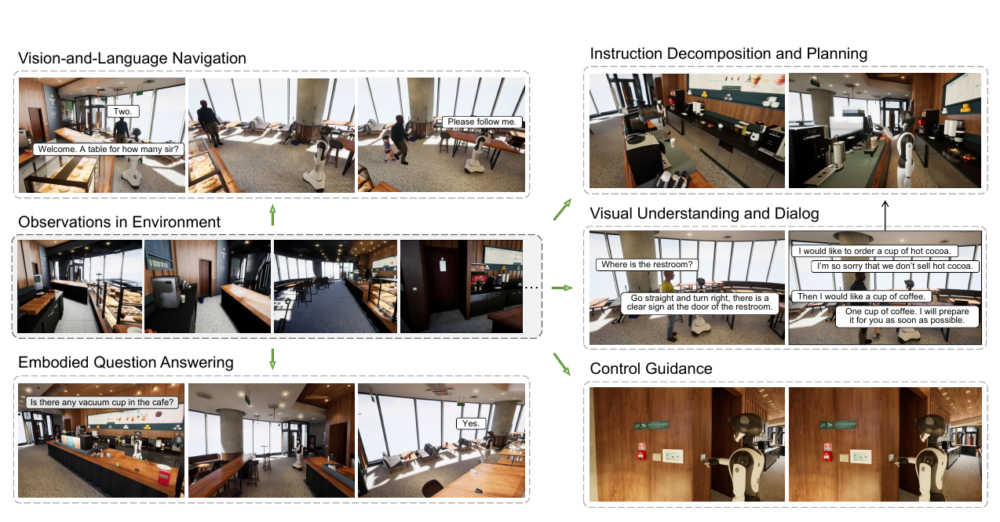
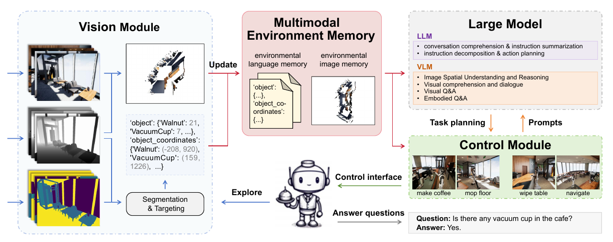
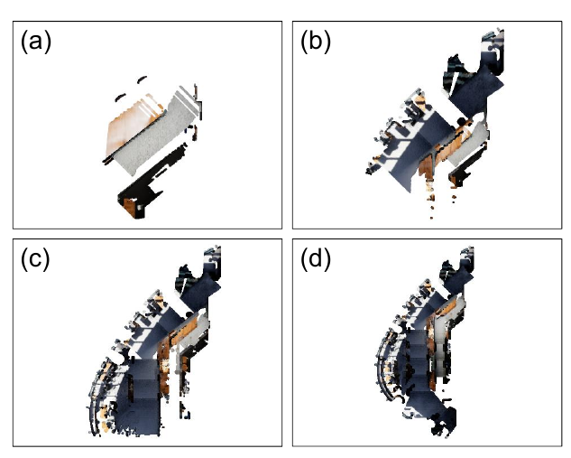
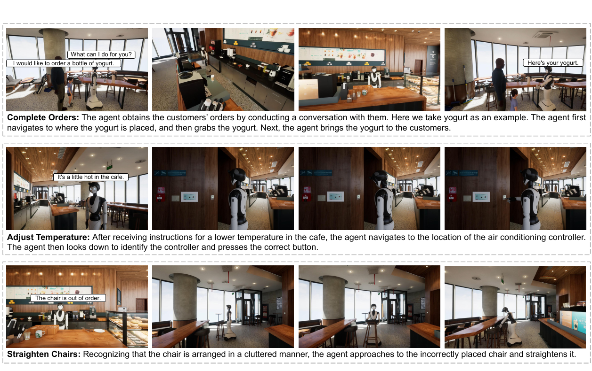
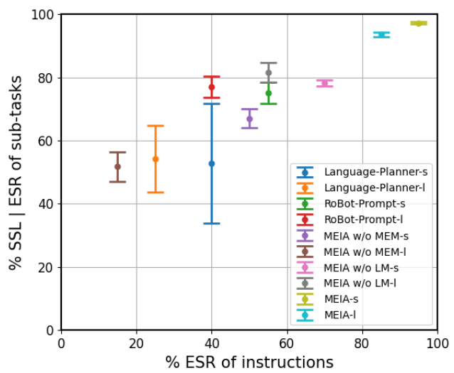
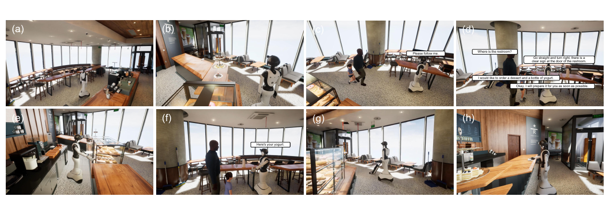

# MEIA：未知环境中的多模态具身感知与交互

> 📄 对应论文原文：[MEIA: Multimodal Embodied Perception and Interaction in Unknown Environments](https://arxiv.org/abs/2402.00290)
> 翻译整理：Codex
> 最后更新：2026-11-01

原题：MEIA: Multimodal Embodied Perception and Interaction in Unknown Environments

作者：Yang Liu、Xinshuai Song、Kaixuan Jiang、Weixing Chen、Jingzhou Luo、Guanbin Li、Liang Lin。单位：中山大学。

作者邮箱：liuy856@mail.sysu.edu.cn；songxsh@mail2.sysu.edu.cn；jiangkx3@mail2.sysu.edu.cn；chen867820261@gmail.com；luojzh5@mail2.sysu.edu.cn；liguanbin@mail.sysu.edu.cn；linliang@ieee.org。

版本：arXiv:2402.00290v3 [cs.CV]，2024 年 7 月 29 日。

译文说明：本译文对应用户提供的 12 页 PDF，包含摘要、正文、全部表格、公式、算法、图注、图中英文文字的中文对照以及参考文献。原图保留作对照，图内文字在相邻文字中翻译；参考文献保留作者及出版信息，翻译文献题名。原文提到但未随本 PDF 提供的附录不在翻译范围内。明确标记的“译者注”不属于原文。

## 摘要

随着大语言模型的迅速发展，具身智能受到越来越多的关注。然而，既有具身智能研究通常以单一模态对场景或历史记忆进行编码，即仅采用视觉或语言，这使得模型的动作规划难以与具身控制相衔接。为克服这一局限，我们提出多模态具身交互智能体（Multimodal Embodied Interactive Agent，MEIA），能够将用自然语言表达的高层任务转化为一系列可执行动作。

具体而言，我们提出一种新的多模态环境记忆（Multimodal Environment Memory，MEM）模块，利用场景的视觉与语言记忆，将具身控制与大模型连接起来。这一能力使 MEIA 能够根据不同需求和机器人的能力，生成可执行的动作计划。此外，我们借助大语言模型，基于动态虚拟咖啡馆环境构建了一个具身问答数据集。在该虚拟环境中，我们通过零样本方式使用多个大模型开展多项实验，并针对不同情形精心设计场景。实验结果表明，MEIA 在多种具身交互任务中具有良好的表现。

## 1 引言

想象你走进一家由机器人服务的咖啡馆。机器人发现你和朋友到来后，会主动上前问候，并根据人数带你们到合适的座位。随后，它前往吧台，接受你们的咖啡和甜点订单，再准备餐饮。与此同时，由于室外气温升高、店内变热，你请机器人放下窗帘并调低空调温度。此外，它还能根据环境回答你提出的问题。这一情景展示了智能体在视觉语言导航、指令分解与规划中的职责，如图 1 所示。

这些任务需要多种能力，包括视觉识别 [Liu et al., 2018c; Liu et al., 2023d; Yan et al., 2023]、目标导航 [Liu et al., 2022b]、语言理解 [Liu et al., 2023c; Wei et al., 2023]、常识推理 [Liu et al., 2023b; Chen et al., 2023]、任务规划 [Zhu et al., 2022; Wang et al., 2023a; Lin et al., 2023] 和物体操作 [Tang et al., 2023]。这种被称为具身人工智能的研究，已成为人工智能与机器人领域的重要方向。

传统人工智能主要从互联网收集的图像 [Liu et al., 2016; Liu et al., 2019; Xu et al., 2022]、视频 [Liu et al., 2022a; Liu et al., 2021; Liu et al., 2018a; Liu et al., 2018b] 或文本 [Liu et al., 2023e] 数据集中学习。与之不同，具身人工智能从类似人类体验的第一视角数据中学习 [Duan et al., 2022]。在具身人工智能任务中，智能体必须依据实时观测收集关键视觉信息，并与物理世界交互 [Liu et al., 2024]。

近年来，大语言模型（LLM）和视觉语言模型（VLM）受到广泛关注。凭借海量网络训练数据，GPT-4 [OpenAI, 2023a]、PaLM [Chowdhery et al., 2023] 和 LLaMA [Touvron et al., 2023] 等大语言模型在对话和推理等任务中展现出强大能力。然而，由于缺少与物理环境的关联，大语言模型在尝试进行物理世界中的简单规划与推理时仍会遇到困难。

一些研究 [Driess et al., 2023; Singh et al., 2023; Song et al., 2023] 尝试把视觉信息融入大语言模型，利用其完成具身任务，并取得了良好效果。另一些研究 [Hu et al., 2023] 选择使用视觉语言模型，将环境观测图像直接纳入推理与规划过程，展现出突出的零样本场景理解和推理表现。不过，仍有两个问题需要解决：第一，如何更好地保存环境信息，为大模型提供更丰富的内容；第二，大语言模型与视觉语言模型能否协同解决具身任务。

为应对上述挑战，我们提出基于大语言模型和视觉语言模型的新型具身模型 MEIA，用于完成物理环境中的具身问答、具身控制等多种任务。MEIA 由三个相互协作的基本模块组成：一是视觉模块，根据周围环境生成环境语言记忆与环境图像记忆；二是控制模块，用于与顾客对话，并执行引导入座、清洁等具身操作；三是大模型，负责推理和动作规划。

良好的环境记忆存储方式有助于智能体记住环境并作出正确决策，从而完成任务。因此，我们提出新的多模态环境记忆（MEM）模块，将物体描述与环境平面图相结合。为进一步提高模型输出的准确性和可行性，我们精心设计提示词，引导大语言模型和视觉语言模型。

此外，我们基于达闼机器人（Dataa Robotics）提供的模拟器，构建了约一千条数据的具身问答数据集。该模拟器提供接近现实的咖啡馆场景，并支持丰富的人机交互设计。我们在该模拟器及自建数据集上评估 MEIA。本文贡献概括如下：

- 提出具身模型 MEIA，将大语言模型与视觉语言模型整合起来，将高层任务转换为可执行动作序列。
- 提出多模态环境记忆（MEM）模块，为 MEIA 提供更细致的具身知识，增强其对物理环境与经验的理解。
- 利用大语言模型高效生成高质量数据，构建具身问答数据集。
- MEIA 展现出较强的零样本能力，能够以良好表现完成具身任务。



图 1：我们提出 MEIA，它能把高层语言指令分解成一系列可执行动作。

图 1 文字对照：视觉语言导航；环境中的观测；具身问答；指令分解与规划；视觉理解与对话；控制引导。对话依次包括：“欢迎光临。先生，请问几位？”“两位。”“请跟我来。”“洗手间在哪里？”“直走然后右转，洗手间门口有清楚的标志。”“我想点一杯热可可。”“非常抱歉，我们不卖热可可。”“那我想点一杯咖啡。”“一杯咖啡，我会尽快为您准备。”“咖啡馆里有保温杯吗？”“有。”

## 2 相关工作

### 2.1 视觉语言模型

视觉语言模型擅长同时理解图像与文本，可用于图像描述生成、视觉问答和常识推理等任务。UNITER [Chen et al., 2020]、BLIP [Li et al., 2022] 等既有研究大多依靠视觉 Transformer（ViT）、循环神经网络（RNN）等神经网络构建视觉语言模型，并通过自注意力机制实现文本与图像对齐。

受大语言模型成功的启发，人们越来越关注大规模视觉语言模型的构建。一些工作 [Li et al., 2023; Dai et al., 2023; Liu et al., 2023a] 借助视觉模型，将预训练大语言模型与视觉推理相结合。在本研究中，我们因 GPT-4-Vision 的优良表现而选择它作为视觉语言模型。

### 2.2 环境记忆

保留环境观测对具身任务至关重要，因为缺少与物理环境的关联，可能使大语言模型和视觉语言模型产生不准确的回答和不可行的规划。LLM-Planner [Song et al., 2023]、VELMA [Schumann et al., 2023]、NavGPT [Zhou et al., 2023] 和 LLM-Grounder [Yang et al., 2023] 将视觉观测的文本描述作为输入，或将其加入提示词。然而，由于文本描述的限制，纯文本环境记忆会丢失大量细节。

一些工作使用不同形式的图或地图保存环境信息，如二维俯视地图 [Min et al., 2021; Inoue and Ohashi, 2022]、三维体素地图 [Tan et al., 2023; Murray and Cakmak, 2022]、三维地图 [Hong et al., 2023b] 等。受这些研究启发，我们提出新的多模态环境记忆（MEM）模块：以物体 ID 和坐标作为环境语言记忆，以视觉观测图像作为环境图像记忆。

### 2.3 具身人工智能任务

在具身人工智能中，智能体通过类似人类的第一视角感知与环境交互并学习 [Duan et al., 2022]。具身任务主要包括视觉探索与导航、具身规划、具身控制及具身问答。

其中，具身问答 [Das et al., 2018] 是最复杂的任务：它要求智能体依据视觉探索和导航获得的信息，回答有关物理世界的问题。此外，智能体还需要通过具身规划和具身控制与环境交互，以获取更多信息。

不同于仅使用大语言模型或视觉语言模型解决这些任务的既有研究 [Driess et al., 2023; Singh et al., 2023; Hu et al., 2023; Ding et al., 2023; Yaoxian et al., 2023]，我们将二者整合。我们利用大语言模型理解顾客需求，并对语言表达的任务进行分解与规划；同时利用视觉语言模型实现环境空间理解、位置导航、机器人运动控制以及具身问答。

## 3 仿真配置

MEIA 在达闼机器人提供的模拟器中运行。该模拟器基于 UE5 构建，提供细节丰富的咖啡馆人机交互场景。本节介绍场景与机器人的配置。

### 3.1 场景配置

在场景配置方面，模拟器提供了尽可能贴近现实的咖啡馆环境。与 Habitat [Savva et al., 2019] 等其他模拟器不同，它采用高分辨率模型以及精细的材质和纹理，并通过复杂的物理引擎准确呈现物体动力学与机械行为，使仿真环境中物体的外观和物理特性十分接近现实世界。此外，模拟器提供机器人控制系统和物体交互功能，以实现丰富的人机交互设计。

模拟器中的各类物体为机器人导航与操作训练提供了有力支持。咖啡馆场景包含 13 类、近 800 个物体，其中包括咖啡机、水壶、洗地机、空调、灯光开关等可交互物体。此外，还可以添加 73 类物体。咖啡馆场景如图 1 所示。

### 3.2 机器人配置

仿真环境中的机器人以达闼机器人的 Ginger 人形机器人智能体为基础设计。它具有功能丰富的环境交互接口，支持机器人关节控制、底盘速度控制以及多种传感器仿真。

机器人的视觉能力包括：

- 头部、胸部和腰部相机采集 RGB 图像。
- 头部、胸部和腰部相机采集深度图像。
- 头部相机采集分割图像。

机器人的控制能力包括：

- 精确控制躯干和手臂的 21 个关节，以及双手的 10 个关节。
- 精确移动到指定坐标。
- 通过关节运动控制，即逆运动学（IK）控制，到达指定坐标。
- 抓取、吸附和释放圆柱形物体。

此外，机器人能够显示对话内容，也能执行开关灯、移动桌椅、推车、使用吸尘器、使用咖啡机、操作空调控制面板等复杂交互操作，如图 1 所示。

## 4 MEIA：多模态具身交互与控制智能体

MEIA 的结构如图 2 所示，由视觉模块、控制模块和大模型三个模块组成。视觉模块获得的多模态记忆是 MEIA 的核心。它在控制模块与大模型之间充当桥梁，使大模型能够面向不同需求生成可执行性较高的动作序列，并交由控制模块执行。下面介绍 MEIA 的具体设计。

### 4.1 多模态环境记忆

由于存在领域差异，具身控制与大模型无法直接交互。如何将二者结合，一直是具身人工智能研究的重点。既有工作 [Song et al., 2023; Zhou et al., 2023] 通常用视觉或自然语言中的某一种模态来记忆场景或历史轨迹，这使得大模型给出的计划难以被具身智能体执行。近期，一些研究尝试限定大模型生成的动作计划的范围，以提高可执行性 [Wake et al., 2023a]。

为解决这一问题，我们提出多模态环境记忆（MEM）模块，如图 2 所示。它把用自然语言记录的场景关键物品名称、坐标以及环境二维平面图保存为记忆，引导大模型在不同需求下生成可执行性较高的动作计划。MEM 的具体构建过程如下。



图 2：MEIA 结构图。MEIA 通过视觉模块、控制模块和大模型三个功能模块实现。视觉模块生成的多模态环境记忆，在控制模块与大模型之间发挥桥梁作用，使二者协作完成任务，并实现大模型感知、记忆与具身控制的有效整合。

图 2 文字对照：视觉模块；分割与目标定位；更新；多模态环境记忆；环境语言记忆；环境图像记忆；大模型。LLM：对话理解与指令概括，指令分解与动作规划。VLM：图像空间理解与推理，视觉理解与对话，视觉问答，具身问答。任务规划；提示词；控制模块；煮咖啡、拖地、擦桌子、导航；控制接口；探索；回答问题。“问题：咖啡馆里有保温杯吗？回答：有。”数据示例中的 object 为“物体”，object_coordinates 为“物体坐标”，Walnut 为“核桃”，VacuumCup 为“保温杯”；示例 ID 和坐标分别为核桃 21、(-208, 920)，保温杯 7、(159, 1226)。

#### 环境语言记忆

机器人的视觉接口能够获得不同模态的图像，包括 RGB 图像、深度图像和分割图像。分割图像把场景中不同关键物品对应的像素设为相应 ID 值，从而实现物品分割。我们使用 K-Means 算法计算关键物品的像素坐标，具体见算法 1。

算法 1：中心定位算法。

输入：像素坐标集合列表 C，阈值 ζ。输出：像素坐标中心 c。

```text
1. 初始化 K-Means 算法 cls，设置聚类中心数量 n_clusters = 2。
2. 计算聚类中心 cluster = clf.fit(C)。
3. 计算聚类中心之间的距离：
   d = sqrt(Σ(i=1..2) (cluster₀[i] - cluster₁[i])²)。
4. 若 d > ζ：
5.     c = cluster[0]。
6. 否则：
7.     c = (cluster[0] + cluster[1]) / 2。
8. 结束条件判断。
```

译者注：原文算法中同时使用 cls 与 clf 两种变量名，且在两个聚类中心距离较大时直接取第一个中心；这里保留原文写法，未自行修改算法。

得到像素坐标后，我们计算相机坐标。设相机内参为 f_x、f_y、c_x、c_y，物体像素坐标为 (i, j)，该像素处对应的物体深度为 depth，则有：

```text
x_c = ((i - c_x) / f_x) × depth
y_c = ((j - c_y) / f_y) × depth                         (1)
z_c = depth
```

给定相机坐标 (x_c, y_c, z_c)，相机外参包括旋转矩阵 R 与平移向量 T，因此：

```text
(x_g, y_g, z_g) = R × [x_c, y_c, z_c] + T               (2)
```

得到 Ginger 坐标系中的坐标 (x_g, y_g, z_g) 时，需要注意 Ginger 坐标系与世界坐标系的 x 轴方向相反。此外，该坐标系具有欧拉角 θ_g 和平移向量 T_g。

利用欧拉角计算旋转矩阵 R_g：

```text
      [1     0        0   ]
R_x = [0   cosα    -sinα  ]                            (3)
      [0   sinα     cosα  ]

      [ cosβ   0    sinβ  ]
R_y = [   0    1      0   ]                            (4)
      [-sinβ   0    cosβ  ]

      [cosγ   -sinγ    0  ]
R_z = [sinγ    cosγ    0  ]                            (5)
      [  0       0     1  ]

R_g = R_z × R_y × R_x                                 (6)
```

最终得到世界坐标：

```text
(x_w, y_w, z_w) = R_g × [x_g, -y_g, z_g] + T_g         (7)
```

译者注：原文文字称“x 轴方向相反”，但式（7）对 y 分量取负。这里忠实保留这一不一致，实际实现时应核对模拟器坐标系约定。

#### 环境图像记忆

环境图像记忆是一张环境平面地图：机器人利用探索过程中收集的视觉信息构建三维点云，再将其投影得到该地图。

机器人调用 RGBD 相机采集 RGB 图像和深度图像，从而获得环境视觉信息。对于同一视角下的 RGB 图像与深度图像，我们借助支持快速处理三维数据的开源库 Open3D，依据相机内参构建带有颜色信息的三维点云。

然而，直接叠加多组 RGBD 图像生成的三维点云，会导致所有点云信息相互重叠和遮挡。因此，融合每组图像对应的三维点云时，还需要进行与物体世界坐标计算类似的操作，根据相机位姿施加旋转和平移。

此外，我们通过统计分析识别和去除点云中的离群点。对于点云中的每一个点，选取距离它最近的 n 个点，计算这些点到该点的平均距离。同时，计算全局平均距离 dis_g 和全局标准差 std_g，分别表示点云中各点到其他点的平均距离以及这些距离的标准差。若某一点的平均距离大于 dis_g + std_r × std_g，则将其视为离群点，其中 std_r 指定标准差的倍数。

尽管三维点云比二维图像包含更丰富、更准确的信息，大模型直接处理和分析三维图像仍具有挑战性。因此，我们将三维点云投影到地板所在的平面上。环境平面图能够在一定程度上展示当前环境的探索状态，使模型整体理解咖啡馆环境，并判断是否已完成充分探索。随着探索推进，三维点云不断丰富，环境平面图也包含更多信息，如图 3 所示。



图 3：环境平面图的构建过程。图中 (a)、(b)、(c)、(d) 展示探索过程中逐步积累的环境地图。

将物体 ID、坐标与环境平面图结合，就得到多模态环境记忆。MEM 被设计为全局记忆，使机器人在调用视觉接口时能够更新多模态记忆，从而灵活应对复杂环境。

### 4.2 具身控制

具身控制是机器人完成任务的基本能力，其设计由机器人控制模块和任务需求共同决定。我们封装机器人的能力，并设计灵活的控制接口：

- 移动到目标：指定物品名称，依据环境记忆移动到物品附近。
- 生成并抓取牛奶：在吧台上生成一杯牛奶，由视觉模块识别并引导机器人抓取。
- 煮咖啡：操作咖啡机制作咖啡。
- 倒水：操作水壶倒水。
- 抓取面包：从柜子中抓取面包。
- 控制空调：在视觉语言模型引导下，根据视觉反馈控制空调。
- 拖地：使用拖把拖地。
- 擦桌子：用毛巾擦桌子。
- 控制窗帘：控制窗帘打开或关闭。
- 控制灯光：控制灯光开启或关闭。
- 摆正椅子：将放错位置的椅子摆正。

我们的具身控制能力设计具有通用性，使机器人拥有多种能力。它并不局限于某一种技能，而是能够在复杂场景中成功完成多种任务。具身控制模块不仅为大模型提供“工具”，还结合多模态环境记忆，执行大模型规划的动作序列以完成任务。

### 4.3 具身问答

#### 数据集

我们基于模拟器构建了一个新的数据集。首先，使用 GPT-4 Turbo 构建不同场景，并提供若干参考示例。在提示词引导下，GPT-4 Turbo 将物体 ID 与允许范围内的位置坐标随机组合并输出。随后，根据输出调用生成函数，在环境中生成对应物品，从而实现随机环境构建。

接着，为不同问题类型设计模板，以便大规模生成问题。模板见表 1。然后，根据随机构建的环境，通过提示词引导 GPT-4 Turbo 生成问题及其对应答案，并将其与场景、问题类型组合，构成数据集中的一条数据。对于每一个场景，每种模板生成三组问答对。

数据集包含 70 个生成场景，共 1050 条数据，全部记录在一个 JSON 文件中。最后，我们对数据进行人工检查和修正，并通过控制数据集中答案的分布来确保数据平衡。

表 1：问题模板。

| 类型                  | 模板                                     |
| --------------------- | ---------------------------------------- |
| 位置关系（location）  | 与 <obj> 放在同一张桌子上的物品是什么？  |
| 位置关系（location）  | <obj1> 和 <obj2> 在同一张桌子上吗？      |
| 距离比较（comparing） | <obj1> 离 <obj2> 是否比离 <obj3> 更近？  |
| 存在性（existence）   | 咖啡馆里有 <obj> 吗？                    |
| 存在性（existence）   | 咖啡馆里有我能用来 <做某件事> 的东西吗？ |

#### 具身问答过程

问题、多模态环境记忆以及新探索到的信息，共同作为多模态大语言模型 GPT-4 Turbo with vision 的输入。机器人每到达一个位置，就从前、后、左、右四个方向观察环境，收集新信息。

考虑到模型生成的计划不一定总是可行，我们还把此前失败的计划反馈给模型，以避免它重复类似的无效计划。在所设计提示词的引导下，GPT-4 Turbo with vision 首先判断现有信息是否足以准确回答问题。

如果信息不足，模型就制定动作计划，指挥机器人移动、交互，以获取新的观测；再根据新输入生成输出，从而形成闭环。如果现有信息已足够，模型就综合已有信息回答问题，并结束闭环。

### 4.4 大模型

大模型是 MEIA 的指挥中心。如图 2 所示，我们综合使用大语言模型和视觉语言模型，针对不同任务组合不同大模型，以充分发挥各模型的优势。

大语言模型（LLM）。我们使用 GPT-3.5 Turbo 和 GPT-4 Turbo。GPT-3.5 Turbo 用于概括机器人与顾客之间的对话，并生成自然语言指令，因为这一任务相对简单。GPT-4 Turbo 则用于更复杂的指令分解与规划，这些任务要求大语言模型具有较强的理解、规划和推理能力。

视觉语言模型（VLM）。与开源模型相比，GPT-4 Turbo with vision 在视觉和语言理解方面具有更强的能力。在我们的实验中，它能够对复杂图像形成空间理解，并作出独立判断，从而生成高质量内容。因此，我们使用 GPT-4 Turbo with vision 实现顾客入座引导任务（视觉语言导航）、空间感知对话交互任务（理解咖啡馆内部空间并满足对话需求），以及控制引导任务（判断应执行哪个动作）。此外，如第 4.3 节所述，我们也使用该模型自主决策，解决具身问答问题。

受思维链（Chain-of-Thought，CoT）[Yao et al., 2022] 和上下文学习（In-Context Learning，ICL）[Dong et al., 2022] 思想的启发，我们设计了专门的提示词，使不同大模型能够针对不同情形提供准确、适当的解决方案。详细提示词设计见原文附录。

通过把不同子任务分配给不同大模型，模型能够根据控制模块的能力与多模态环境记忆，对各类任务进行分解和规划，使机器人像人一样与顾客交互并满足其需求。

## 5 实验结果

我们依据现实情形，为所提出的方案设计了一套情境流程，对不同模型在各类任务中的表现进行系统评估和比较。此外，我们还在自建具身问答数据集上测试模型性能，具体如下。

### 5.1 实验设置

根据咖啡馆中服务员与顾客的真实互动，我们设计了一套闭环情境流程。在该闭环流程中，机器人的任务分为三个部分：

- 环境探索：机器人探索环境，形成初始多模态环境记忆。
- 人机交互：机器人选择适当位置等待顾客，与顾客交流，回答问题并理解需求。
- 任务理解与执行：机器人理解顾客要求，形成相应动作计划，并执行任务以满足需求。在此期间，机器人智能体可能遇到异常提示，如地面上有垃圾，需要处理这些异常情况。图 4 展示三个任务。

当顾客的需求全部得到满足后，智能体重新回到人机交互任务。此外，我们使用 GPT-3.5 从可执行子任务中随机采样，并生成口语化指令，以模拟真实的人机交互场景，作为评估不同模型性能的测试案例。



图 4：任务执行。我们展示了三个任务，并简要描述各自的实现过程。

完成订单：智能体通过与顾客对话获取订单。这里以酸奶为例：智能体首先导航到放置酸奶的位置，再抓取酸奶，最后把酸奶送给顾客。图中对话为：“有什么可以帮您？”“我想点一瓶酸奶。”“这是您的酸奶。”

调节温度：收到降低咖啡馆温度的指令后，智能体导航到空调控制器所在位置，低头识别控制器并按下正确按钮。图中指令为：“咖啡馆里有点热。”

摆正椅子：发现椅子摆放凌乱后，智能体走到位置不正确的椅子旁，将其摆正。图中提示为：“椅子没有摆好。”

### 5.2 结果与比较

我们将先进模型和方法 [Zhu et al., 2023; Wang et al., 2023b; Huang et al., 2022; Wake et al., 2023b] 纳入实验比较。通过提示词工程，以零样本方式获得大模型输出。具体实验细节见原文所提交的附录。

#### 指标

我们使用可执行成功率（Executable Success Rate，ESR）评价模型表现，定义为：

```text
ESR = n_e / N                                         (8)
```

其中 n_e 为成功执行次数，N 为任务总数。当模型给出的输出或计划能够在模拟器中成功执行并完成任务时，记为一次成功。

此外，我们使用按步骤长度加权的成功率（Success Rate Weighted by Step Length，SSL）衡量不同模型与方法所给计划的准确性和效率：

```text
SSL = (1/N) × Σ(i=1..N) [s_i × l_c / max(l_g, l_p)]    (9)
```

其中 N 为任务总数，s_i 为规划执行成功率，l_g 为基准规划长度，l_p 为大模型生成的规划长度，l_c 为规划中正确步骤的长度。

译者注：以上按原文保留符号与定义，原式中只有 s_i 显式带有任务下标。

#### 子任务评估

子任务评估根据实验情境中机器人智能体所需能力设计，包括视觉问答，以及空间理解与推理。我们使用近期的大型视觉语言模型 MiniGPT-4 [Zhu et al., 2023]、CogVLM [Wang et al., 2023b] 和 CogAgent [Hong et al., 2023a] 进行子任务评估。每项任务对每个模型评估 50 次。

视觉问答：我们选择机器人需要识别空调控制器，并按照指令选择正确控制按钮的场景。

空间理解与推理：我们选择视觉导航任务进行评估。机器人需要根据场景与顾客要求，在图像中选择合适的位置。评估结果见表 2。

表 2：子任务评估。

| 模型                          | 视觉问答 | 空间理解与推理 |
| ----------------------------- | -------- | -------------- |
| MiniGPT-4 [Zhu et al., 2023]  | 44%      | 8%             |
| CogVLM [Wang et al., 2023b]   | 52%      | 38%            |
| CogAgent [Hong et al., 2023a] | 46%      | 32%            |
| GPT4-V [OpenAI, 2023b]        | 98%      | 94%            |

MiniGPT-4 具有较强的语言能力，能够有效理解提示词内容，输出基本符合格式要求的结果。然而，其视觉能力有限，难以理解低分辨率且复杂的图像，妨碍了任务的有效完成。

CogVLM 的视觉能力相对突出，能够有效识别复杂图像中的各类目标，并形成适当理解；但它对提示词的把握不足，难以生成所需回答。CogAgent 在 CogVLM 设计基础上构建，在我们的评估中，两者准确率没有显著差异，但 CogAgent 回答的可执行性明显强于 CogVLM。

GPT4-V 的表现显著优于这些开源模型，并在各类任务中保持很高性能。这也是后续实验的基础。

#### 指令规划评估

为比较 MEIA 与现有方法，我们设计了指令规划评估。我们使用 GPT-3.5 对咖啡馆场景中的事件和任务进行采样，生成包含一定数量子任务的自然语言指令，作为评估案例。

为了比较指令中的子任务数量对模型规划性能的影响，我们将生成指令分成两类：包含 3 至 5 个子任务的长指令，以及包含 2 至 3 个子任务的短指令。每类任务生成 20 个样本，在模拟器中开展实验，评估模型的 ESR 和 SSL 指标。指令生成提示词、部分评估示例与结果见原文附录。

我们评估了近期模型 Language-Planner [Huang et al., 2022] 和 Robot-Prompt [Wake et al., 2023b]。Language-Planner 使用大语言模型进行规划，把示例集中最相关的示例、对应动作以及待完成任务一起作为提示词。Robot-Prompt 则使用思维链方法，通过多轮对话和用户反馈形成较高性能的动作规划。

我们根据模拟器环境、机器人能力和任务需求，对 Language-Planner 与 Robot-Prompt 进行了适当调整。Language-Planner 的超参数 CUTOFF 设置为 0.6，示例数量为 10。我们按照 Robot-Prompt 的要求，对咖啡馆三维环境进行格式化描述。关于超参数的更多实验结果，以及咖啡馆环境的文本格式描述，请参见原文附录。使用 GPT-3.5 生成样本进行评估，结果见表 3。

表 3：指令规划评估结果。ESR(a) 为整条指令的 ESR，ESR(b) 为指令中子任务的 ESR。为便于阅读，将原表按短、长指令拆为两表，数据保持不变。

| 模型：短指令                          | ESR(a) | ESR(b) | SSL    |
| ------------------------------------- | ------ | ------ | ------ |
| Language-Planner [Huang et al., 2022] | 40%    | 71.67% | 33.92% |
| Robot-Prompt [Wake et al., 2023b]     | 55%    | 78.33% | 71.80% |
| MEIA 无 MEM                           | 50%    | 70.00% | 64.12% |
| MEIA 无 Large Model*                  | 70%    | 79.16% | 77.17% |
| MEIA                                  | 95%    | 97.50% | 97.00% |

| 模型：长指令                          | ESR(a) | ESR(b) | SSL    |
| ------------------------------------- | ------ | ------ | ------ |
| Language-Planner [Huang et al., 2022] | 25%    | 64.67% | 43.61% |
| Robot-Prompt [Wake et al., 2023b]     | 40%    | 80.25% | 73.59% |
| MEIA 无 MEM                           | 15%    | 56.33% | 47.13% |
| MEIA 无 Large Model*                  | 55%    | 84.58% | 78.51% |
| MEIA                                  | 85%    | 94.17% | 92.82% |

表 3 注：原文的“MEIA w/o Large Model”并非完全移除大模型，而是用 GPT-3.5 替换 GPT-4。

如表 3 所示，MEIA 的表现远超 Language-Planner 与 Robot-Prompt。我们将这一优势归因于多模态环境记忆：它使模型能够更有逻辑地理解环境，从而确保规划的顺序与连贯性。这体现在 MEIA 与其他模型的整条指令 ESR 差距，远大于各自子任务 ESR 的差距。

指令长度对模型性能的影响主要体现在整条指令完成率，而对子任务完成率和规划准确性的影响较小。即使指令增多，模型规划也可能趋于稳定，使成功率略有提高。

如图 5 所示，整条指令 ESR 与 SSL 的差异反映模型规划的精确性。由于 Language-Planner 根据示例与动作的相似性生成计划，其规划常有混乱和冗余，导致 SSL 尤其低。Robot-Prompt 缺少对动作的逻辑理解，偶尔会遗漏关键动作，导致 SSL 降低。



图 5：指令规划评估结果。后缀 -s 表示短指令，-l 表示长指令。横轴文字为“整条指令的 ESR（%）”，纵轴文字为“SSL／子任务 ESR（%）”。图例包括 Language-Planner-s、Language-Planner-l、Robot-Prompt-s、Robot-Prompt-l、MEIA 无 MEM-s、MEIA 无 MEM-l、MEIA 无 LM-s、MEIA 无 LM-l、MEIA-s 和 MEIA-l。MEM 为多模态环境记忆；此处“无 LM”对应表 3 中用 GPT-3.5 替换 GPT-4 的设置。

#### 全流程评估

我们对完整情境流程进行评估。由于每次评估包含十个以上子任务，现有模型或方法单独使用时，无法完成我们设计的流程。因此，我们使用结合 GPT-3.5、GPT-4、GPT4-V 等大模型的 MEIA 进行实验。任务执行过程见图 6。

在 20 轮实验中，MEIA 的 ESR 达到 95%。这意味着 MEIA 在规划方面具有很高的准确性与可执行性。

我们也研究了失败案例。其中一个案例中，模型在响应“桌子脏了”时出错：它忽略了先“拿毛巾”这一步，而是直接走向桌子。这反映大模型对具身控制能力与现实场景之间关系的理解仍然不足。



图 6：全流程评估。(a) 智能体探索环境，构建多模态环境记忆；(b)、(c) 智能体等待顾客，并引导其到合适的座位；(d) 智能体与顾客交谈，对对话内容进行概括，以提取需求；(e)、(f) 智能体规划并执行动作序列，完成订单；(g)、(h) 智能体根据指令完成其他任务，如清洁地板、擦桌子。

图 6 对话翻译：“请跟我来。”“洗手间在哪里？”“直走然后右转，洗手间门口有清楚的标志。”“我想点一份甜点和一瓶酸奶。”“好的，我会尽快为您准备。”“这是您的酸奶。”

#### 消融实验

我们针对 MEIA 的多模态环境记忆（MEM）与大模型开展消融实验，以验证其有效性。实验设置与指令规划评估相同，结果见表 3 与图 5。

将大模型由 GPT-4 换成 GPT-3.5 后，模型性能持续下降，反映出大模型对指令规划的重要性。移除多模态环境记忆后，性能下降更加明显，尤其是整条指令 ESR，比降低大模型能力时退步更大。同时，子任务 ESR 与 SSL 之间的差距也显著扩大，反映规划精确性降低。

我们将其归因于多模态环境记忆的缺失。缺少该记忆会迫使大模型更加关注指令文本本身，但指令描述的精确程度不足以支持机器人成功执行任务，从而影响任务执行成功率。

### 5.3 具身问答评估

此外，我们还对模型的具身问答任务表现进行评估。我们从数据集中随机选取 6 个场景，共 90 个问题，分别进行单轮问答与多轮问答实验。

在单轮问答中，机器人收到问题时，环境记忆为空，每次都从头探索。在多轮问答中，为回答先前问题而探索得到的环境信息，可用于生成当前问题的答案。每个场景中的每组问答对视为一轮测试。

实验结果见表 4。评估指标包括平均准确率、平均探索次数、平均不可达规划次数和平均路径长度。

- 平均准确率（ACC）：多个问题中回答正确的比例。
- 平均探索次数（EC）：机器人移动到模型规划的下一个探索位置的次数，不包括机器人在起始位置进行的初始探索。
- 平均不可达规划次数（UPC）：模型规划的环境位置中，机器人实际上无法到达的位置数量。
- 平均路径长度（PL）：从收到问题到生成答案，机器人在环境中导航的总距离，单位为厘米。

表 4：单轮问答与多轮问答结果比较。

| 问答方式 | ACC | EC   | UPC | PL（厘米） |
| -------- | --- | ---- | --- | ---------- |
| 单轮问答 | 70% | 22   | 3.5 | 4769.9     |
| 多轮问答 | 72% | 19.3 | 1   | 3800.7     |

从表 4 可以看出，在准确率相当甚至提高的同时，多轮问答在平均探索次数、平均不可达规划次数和平均路径长度上，均优于单轮问答。尤其是平均不可达规划次数降低了 70% 以上。

这一结果说明环境记忆和历史碰撞信息对模型规划过程有效。利用探索得到的环境记忆与历史碰撞信息，模型能够更好地理解整体环境、规划动作，并更快探索到回答问题所需的环境信息。

#### 消融实验

为进一步验证记忆模块的有效性，我们报告具身问答任务的消融实验结果。分别测试四种模型：MEIA、不含多模态环境记忆（MEM）的 MEIA、不含环境语言记忆（ELM）的 MEIA，以及不含环境图像记忆（EIM）的 MEIA。针对每种模型，我们分别计算不同问题类型的平均准确率，结果见表 5。

表 5：消融实验中不同问题类型的平均准确率比较。

| 模型        | 位置关系 | 距离比较 | 存在性 | 总体  |
| ----------- | -------- | -------- | ------ | ----- |
| MEIA 无 MEM | 38.9%    | 50.0%    | 77.8%  | 56.7% |
| MEIA 无 ELM | 41.7%    | 50.0%    | 77.8%  | 57.8% |
| MEIA 无 EIM | 50.0%    | 55.6%    | 80.6%  | 63.3% |
| MEIA        | 55.6%    | 66.7%    | 86.1%  | 70.0% |

显然，MEIA 在四种模型中表现最好。缺少环境语言记忆或环境图像记忆，都会影响模型表现。此外，在没有环境语言记忆时，单独加入环境图像记忆，并不能显著改善模型性能。

还可以看出，模型在位置关系类问题上表现最差，其次是距离比较类问题。这在一定程度上反映出 MEIA 的空间推理能力有限，整体表现仍有提升空间。

## 6 结论

本文提出用于完成具身任务的 MEIA，并构建了约一千条数据的具身问答数据集。在物理环境中，智能体收集第一视角环境信息，执行具身控制，并完成具身任务。

我们创新性地引入多模态记忆，保存全局记忆并实时更新，从而连接具身控制与大模型。实验表明，MEIA 在解决多种具身任务方面展现出良好潜力。

译者注：本 PDF 报告的实验均在咖啡馆模拟器中开展。上文“物理环境”为原文的表述，不表示本文已报告真实机器人部署实验。

## 参考文献

以下保留原文的引用标识、作者、发表信息与编号；文献题名译为中文，期刊、会议名称保留便于检索的原名。

[Chen et al., 2020] Yen-Chun Chen, Linjie Li, Licheng Yu, Ahmed El Kholy, Faisal Ahmed, Zhe Gan, Yu Cheng, and Jingjing Liu. UNITER：通用图像-文本表征学习。European Conference on Computer Vision，104-120 页。Springer，2020。

[Chen et al., 2023] Weixing Chen, Yang Liu, Ce Wang, Guanbin Li, Jiarui Zhu, and Liang Lin. 用于放射学报告生成的视觉-语言因果干预。arXiv:2303.09117，2023。

[Chowdhery et al., 2023] Aakanksha Chowdhery, Sharan Narang, Jacob Devlin, Maarten Bosma, Gaurav Mishra, Adam Roberts, Paul Barham, Hyung Won Chung, Charles Sutton, Sebastian Gehrmann, et al. PaLM：利用 Pathways 扩展语言建模规模。Journal of Machine Learning Research，24(240):1-113，2023。

[Dai et al., 2023] Wenliang Dai, Junnan Li, Dongxu Li, Anthony Meng Huat Tiong, Junqi Zhao, Weisheng Wang, Boyang Li, Pascale Fung, and Steven Hoi. InstructBLIP：通过指令微调迈向通用视觉语言模型。2023。

[Das et al., 2018] Abhishek Das, Samyak Datta, Georgia Gkioxari, Stefan Lee, Devi Parikh, and Dhruv Batra. 具身问答。Proceedings of the IEEE Conference on Computer Vision and Pattern Recognition，1-10 页，2018。

[Ding et al., 2023] Yan Ding, Xiaohan Zhang, Chris Paxton, and Shiqi Zhang. 利用大语言模型中的常识知识进行任务与运动规划。RSS 2023 Workshop on Learning for Task and Motion Planning，2023。

[Dong et al., 2022] Qingxiu Dong, Lei Li, Damai Dai, Ce Zheng, Zhiyong Wu, Baobao Chang, Xu Sun, Jingjing Xu, Lei Li, and Zhifang Sui. 上下文学习综述。arXiv:2301.00234，2022 年 12 月。

[Driess et al., 2023] Danny Driess, Fei Xia, Mehdi SM Sajjadi, Corey Lynch, Aakanksha Chowdhery, Brian Ichter, Ayzaan Wahid, Jonathan Tompson, Quan Vuong, Tianhe Yu, et al. PaLM-E：具身多模态语言模型。arXiv:2303.03378，2023。

[Duan et al., 2022] Jiafei Duan, Samson Yu, Hui Li Tan, Hongyuan Zhu, and Cheston Tan. 具身人工智能综述：从模拟器到研究任务。IEEE Transactions on Emerging Topics in Computational Intelligence，6(2):230-244，2022。

[Hong et al., 2023a] Wenyi Hong, Weihan Wang, Qingsong Lv, Jiazheng Xu, Wenmeng Yu, Junhui Ji, Yan Wang, Zihan Wang, Yuxiao Dong, Ming Ding, and Jie Tang. CogAgent：面向图形用户界面智能体的视觉语言模型。arXiv:2312.08914，2023 年 12 月。

[Hong et al., 2023b] Yining Hong, Haoyu Zhen, Peihao Chen, Shuhong Zheng, Yilun Du, Zhenfang Chen, and Chuang Gan. 3D-LLM：将三维世界注入大语言模型。arXiv:2307.12981，2023。

[Hu et al., 2023] Yingdong Hu, Fanqi Lin, Tong Zhang, Li Yi, and Yang Gao. 三思而后行：揭示 GPT-4V 在机器人视觉语言规划中的能力。arXiv:2311.17842，2023。

[Huang et al., 2022] Wenlong Huang, Pieter Abbeel, Deepak Pathak, and Igor Mordatch. 作为零样本规划器的语言模型：为具身智能体提取可执行知识。arXiv:2201.07207，2022。

[Inoue and Ohashi, 2022] Yuki Inoue and Hiroki Ohashi. Prompter：利用大语言模型提示实现数据高效的具身指令遵循。arXiv:2211.03267，2022。

[Li et al., 2022] Junnan Li, Dongxu Li, Caiming Xiong, and Steven Hoi. BLIP：通过自举式语言-图像预训练统一视觉语言理解与生成。International Conference on Machine Learning，12888-12900 页。PMLR，2022。

[Li et al., 2023] Junnan Li, Dongxu Li, Silvio Savarese, and Steven Hoi. BLIP-2：利用冻结的图像编码器与大语言模型进行自举式语言-图像预训练。arXiv:2301.12597，2023。

[Lin et al., 2023] Junfan Lin, Yuying Zhu, Lingbo Liu, Yang Liu, Guanbin Li, and Liang Lin. DenseLight：利用密集反馈高效控制大规模交通信号。Edith Elkind 编，Proceedings of the Thirty-Second International Joint Conference on Artificial Intelligence，IJCAI-23，6058-6066 页。International Joint Conferences on Artificial Intelligence Organization，2023 年 8 月，AI for Good。

[Liu et al., 2016] Yang Liu, Jing Li, ZhaoYang Lu, Tao Yang, and ZiJian Liu. 融合多种特征的跨域人脸素描识别。Biometric Recognition: 11th Chinese Conference, CCBR 2016, Chengdu, China, October 14-16, 2016, Proceedings 11，139-146 页。Springer，2016。

[Liu et al., 2018a] Yang Liu, Zhaoyang Lu, Jing Li, and Tao Yang. 用于跨视角动作识别的分层学习视角不变表征。IEEE Transactions on Circuits and Systems for Video Technology，29(8):2416-2430，2018。

[Liu et al., 2018b] Yang Liu, Zhaoyang Lu, Jing Li, Tao Yang, and Chao Yao. 基于全局时序表征的卷积神经网络用于红外动作识别。IEEE Signal Processing Letters，25(6):848-852，2018。

[Liu et al., 2018c] Yang Liu, Zhaoyang Lu, Jing Li, Chao Yao, and Yanzi Deng. 用于可见光到红外跨数据集人体动作识别的可迁移特征表征。Complexity，2018:1-20，2018。

[Liu et al., 2019] Yang Liu, Zhaoyang Lu, Jing Li, Tao Yang, and Chao Yao. 用于动作识别的深度图像到视频适应与融合网络。IEEE Transactions on Image Processing，29:3168-3182，2019。

[Liu et al., 2021] Yang Liu, Keze Wang, Guanbin Li, and Liang Lin. 用于传感器到视觉动作识别的语义感知自适应知识蒸馏。IEEE Transactions on Image Processing，30:5573-5588，2021。

[Liu et al., 2022a] Yang Liu, Keze Wang, Lingbo Liu, Haoyuan Lan, and Liang Lin. TCGL：用于自监督视频表征学习的时序对比图。IEEE Transactions on Image Processing，31:1978-1993，2022。

[Liu et al., 2022b] Yang Liu, Yu-Shen Wei, Hong Yan, Guan-Bin Li, and Liang Lin. 因果推理与视觉表征学习的结合：前瞻性研究。Machine Intelligence Research，19(6):485-511，2022。

[Liu et al., 2023a] Haotian Liu, Chunyuan Li, Qingyang Wu, and Yong Jae Lee. 视觉指令微调。arXiv:2304.08485，2023。

[Liu et al., 2023b] Yang Liu, Weixing Chen, Guanbin Li, and Liang Lin. CausalVLR：视觉-语言因果推理工具箱与基准。arXiv:2306.17462，2023。

[Liu et al., 2023c] Yang Liu, Guanbin Li, and Liang Lin. 面向事件级视觉问答的跨模态因果关系推理。IEEE Transactions on Pattern Analysis and Machine Intelligence，2023。

[Liu et al., 2023d] Yang Liu, Ying Tan, and Haoyuan Lan. 用于视听动作识别的自监督对比学习。2023 IEEE International Conference on Image Processing (ICIP)，1000-1004 页。IEEE，2023。

[Liu et al., 2023e] Yang Liu, Ying Tan, Jingzhou Luo, and Weixing Chen. VCD：用于跨模态问题推理的视觉因果发现。Chinese Conference on Pattern Recognition and Computer Vision (PRCV)，309-322 页。Springer，2023。

[Liu et al., 2024] Yang Liu, Weixing Chen, Yongjie Bai, Guanbin Li, Wen Gao, and Liang Lin. 连接网络空间与物理世界：具身人工智能全面综述。arXiv:2407.06886，2024。

[Min et al., 2021] So Yeon Min, Devendra Singh Chaplot, Pradeep Ravikumar, Yonatan Bisk, and Ruslan Salakhutdinov. FILM：通过模块化方法遵循语言指令。arXiv:2110.07342，2021。

[Murray and Cakmak, 2022] Michael Murray and Maya Cakmak. 通过地标引导搜索与强化位姿调整，遵循家庭任务的自然语言指令。IEEE Robotics and Automation Letters，7(3):6870-6877，2022。

[OpenAI, 2023a] OpenAI. GPT-4 技术报告。2023。

[OpenAI, 2023b] OpenAI. GPT-4V（视觉）系统卡。2023。

[Savva et al., 2019] Manolis Savva, Abhishek Kadian, Oleksandr Maksymets, Yili Zhao, Erik Wijmans, Bhavana Jain, Julian Straub, Jia Liu, Vladlen Koltun, Jitendra Malik, Devi Parikh, and Dhruv Batra. Habitat：具身人工智能平台。2019 IEEE/CVF International Conference on Computer Vision (ICCV)，2019 年 10 月。

[Schumann et al., 2023] Raphael Schumann, Wanrong Zhu, Weixi Feng, Tsu-Jui Fu, Stefan Riezler, and William Yang Wang. VELMA：面向街景视觉语言导航的大语言模型智能体言语化具身。arXiv:2307.06082，2023。

[Singh et al., 2023] Ishika Singh, Valts Blukis, Arsalan Mousavian, Ankit Goyal, Danfei Xu, Jonathan Tremblay, Dieter Fox, Jesse Thomason, and Animesh Garg. ProgPrompt：使用大语言模型生成情境化机器人任务计划。2023 IEEE International Conference on Robotics and Automation (ICRA)，11523-11530 页。IEEE，2023。

[Song et al., 2023] Chan Hee Song, Jiaman Wu, Clayton Washington, Brian M Sadler, Wei-Lun Chao, and Yu Su. LLM-Planner：面向具身智能体的少样本环境关联规划。Proceedings of the IEEE/CVF International Conference on Computer Vision，2998-3009 页，2023。

[Tan et al., 2023] Sinan Tan, Mengmeng Ge, Di Guo, Huaping Liu, and Fuchun Sun. 基于知识的具身问答。IEEE Transactions on Pattern Analysis and Machine Intelligence，2023。

[Tang et al., 2023] Ziyi Tang, Ruilin Wang, Weixing Chen, Keze Wang, Yang Liu, Tianshui Chen, and Liang Lin. 迈向 CausalGPT：通过促进大语言模型中的因果一致性，以多智能体方法实现忠实的知识推理。arXiv:2308.11914，2023。

[Touvron et al., 2023] Hugo Touvron, Thibaut Lavril, Gautier Izacard, Xavier Martinet, Marie-Anne Lachaux, Timothée Lacroix, Baptiste Rozière, Naman Goyal, Eric Hambro, Faisal Azhar, et al. LLaMA：开放且高效的基础语言模型。arXiv:2302.13971，2023。

[Wake et al., 2023a] Naoki Wake, Atsushi Kanehira, Kazuhiro Sasabuchi, Jun Takamatsu, and Katsushi Ikeuchi. ChatGPT 赋能不同环境中的长步骤机器人控制：一个应用案例。arXiv:2304.03893v6，2023 年 4 月。

[Wake et al., 2023b] Naoki Wake, Atsushi Kanehira, Kazuhiro Sasabuchi, Jun Takamatsu, and Katsushi Ikeuchi. ChatGPT 赋能不同环境中的长步骤机器人控制：一个应用案例。IEEE Access，11:95060-95078，2023。

[Wang et al., 2023a] Kuo Wang, LingBo Liu, Yang Liu, GuanBin Li, Fan Zhou, and Liang Lin. 城市区域功能引导的交通流预测。Information Sciences，634:308-320，2023。

[Wang et al., 2023b] Weihan Wang, Qingsong Lv, Wenmeng Yu, Wenyi Hong, Ji Qi, Yan Wang, Junhui Ji, Zhuoyi Yang, Lei Zhao, Xixuan Song, et al. CogVLM：预训练语言模型的视觉专家。arXiv:2311.03079，2023。

[Wei et al., 2023] Yushen Wei, Yang Liu, Hong Yan, Guanbin Li, and Liang Lin. 用于视频问答的视觉因果场景细化。MM '23，377-386 页，New York, NY, USA，2023。Association for Computing Machinery。

[Xu et al., 2022] Xiaoqian Xu, Pengxu Wei, Weikai Chen, Yang Liu, Mingzhi Mao, Liang Lin, and Guanbin Li. 面向跨设备真实世界图像超分辨率的双重对抗适应。Proceedings of the IEEE/CVF Conference on Computer Vision and Pattern Recognition，5667-5676 页，2022。

[Yan et al., 2023] Hong Yan, Yang Liu, Yushen Wei, Zhen Li, Guanbin Li, and Liang Lin. SkeletonMAE：用于骨架序列预训练的基于图的掩码自编码器。Proceedings of the IEEE/CVF International Conference on Computer Vision，5606-5618 页，2023。

[Yang et al., 2023] Jianing Yang, Xuweiyi Chen, Shengyi Qian, Nikhil Madaan, Madhavan Iyengar, David F Fouhey, and Joyce Chai. LLM-Grounder：以大语言模型为智能体的开放词汇三维视觉定位。arXiv:2309.12311，2023。

[Yao et al., 2022] Shunyu Yao, Jeffrey Zhao, Dian Yu, Nan Du, Izhak Shafran, Karthik Narasimhan, and Yuan Cao. ReAct：在语言模型中协同推理与行动。arXiv:2210.03629，2022 年 10 月。

[Yaoxian et al., 2023] Song Yaoxian, Sun Penglei, Liu Haoyu, Li Zhixu, Song Wei, Xiao Yanghua, and Zhou Xiaofang. 面向具身人工智能的场景驱动多模态知识图谱构建。arXiv:2311.03783，2023。

[Zhou et al., 2023] Gengze Zhou, Yicong Hong, and Qi Wu. NavGPT：视觉语言导航中的显式推理与大语言模型。arXiv:2305.16986，2023。

[Zhu et al., 2022] Yuying Zhu, Yang Zhang, Lingbo Liu, Yang Liu, Guanbin Li, Mingzhi Mao, and Liang Lin. 用于窃电检测的混合阶表征学习。IEEE Transactions on Industrial Informatics，19(2):1248-1259，2022。

[Zhu et al., 2023] Deyao Zhu, Jun Chen, Xiaoqian Shen, Xiang Li, and Mohamed Elhoseiny. MiniGPT-4：利用先进大语言模型增强视觉语言理解。arXiv:2304.10592，2023。
